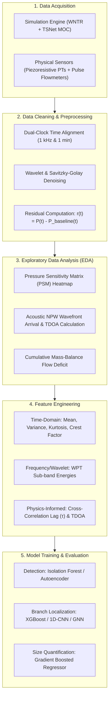

# End-to-End Leak Detection & Localization Pipeline: Technical Report Blueprint

This document outlines the standardized methodology for reporting and implementing pipeline leak and burst intelligence, bridging synthetic simulation data (**EPANET / TSNet**) and real-world physical instrumentation (**Tabletop prototype / SCADA / DAQ**).

---

## 1. Pipeline Architecture



---

## 2. Step 1: Data Acquisition & Logging Strategy

### A. Simulation Framework (Digital Twin)
* **Quasi-Steady State (EPANET / WNTR)**:
  * **Objective**: Model long-term operational windows (e.g., 30-minute intermittent supply) and steady-state pressure deficits ($\Delta P$).
  * **Sampling Rate**: $1.0\text{ minute}$ ($1/60\text{ Hz}$).
  * **Parameters logged**: Node pressure ($m$), link flowrate ($\text{L/s}$), emitter leak demand ($\text{L/s}$).
* **Transient Dynamics (TSNet / Method of Characteristics)**:
  * **Objective**: Capture acoustic water hammer shockwaves, negative pressure wave (NPW) reflection, and sub-second ringing.
  * **Sampling Rate**: $\Delta t \approx 0.0005\text{–}0.004\text{ s}$ ($250\text{ Hz}\text{–}2,000\text{ Hz}$), governed by the Courant condition:
    $$\Delta t = \frac{\Delta x}{a}$$
    where $a$ is the acoustic wave speed ($1,200\text{ m/s}$ in metal; $300\text{ m/s}$ in plastic/PVC).
  * **Parameters logged**: Instantaneous dynamic head ($m$), pipe velocity ($m/s$).

### B. Physical Rig & Real-World Network Setup
* **Pressure Sensors**:
  * **High-Speed Transducers**: Piezoresistive pressure transmitters (e.g., $0\text{–}1\text{ bar}$ or $0\text{–}5\text{ bar}$, $4\text{–}20\text{ mA}$ or $0\text{–}5\text{ V}$) connected to high-speed ADC/DAQ (e.g., LabVIEW NI USB-6009, Raspberry Pi with ADS1115, or ESP32 sampling at $1\text{ kHz}$).
  * **Mounting**: Tapped via push-fit tees or saddle clamps into main junctions (`J1`, `J2`, `J3`) and sub-lines (`OUT_1A`, `OUT_2A`).
* **Flow Sensors**:
  * In-line hall-effect turbine or electromagnetic flowmeter placed at the supply header (`V_MAIN`) logging at $1\text{–}10\text{ Hz}$.

---

## 3. Step 2: Data Cleaning & Preprocessing

Real-world sensor streams and simulation outputs require specific normalization and cleaning before feeding into models:

### 1. Dual-Clock Resampling & Synchronization
* **The Problem**: Flow meters typically output at $1\text{–}5\text{ Hz}$, SCADA pressure at $0.1\text{–}1\text{ Hz}$, and dynamic pressure transducers at $1,000\text{ Hz}$.
* **Action**:
  * Split data into two processing streams:
    * **Fast-Stream (Acoustic)**: Preserves raw $1\text{ kHz}$ data within a $5\text{-second}$ window around sudden events for burst localization.
    * **Slow-Stream (Macro-Hydraulic)**: Resamples all continuous signals to a common $1\text{-second}$ or $1\text{-minute}$ grid using median decimation.

### 2. Denoising & Filtering
* **High-Frequency Electrical / Ambient Noise**:
  * Apply a **Savitzky-Golay filter** (preserves sharp wave edges while removing high-frequency sensor noise) or **Discrete Wavelet Transform (DWT)** thresholding with Symlet (`sym4`) or Daubechies (`db4`) wavelets.
* **Sensor Drift & Elevation Calibration**:
  * Subtract static sensor elevation offset: $P_{\text{corr}} = P_{\text{meas}} - z_{\text{sensor}}$.

### 3. Residual Formulation (Physics-Informed Normalization)
Raw pressure varies with fluctuating customer demand. Rather than training models on absolute pressure $P_i(t)$, compute the **Pressure Residual Vector** $\mathbf{r}(t)$:
$$r_i(t) = P_i^{\text{observed}}(t) - P_i^{\text{baseline}}(t)$$
* If $\mathbf{r}(t) \approx \mathbf{0}$, the network is healthy.
* If $r_i(t) < 0$, a leak or burst has occurred upstream of or near node $i$.

---

## 4. Step 3: Exploratory Data Analysis (EDA)

In your report, EDA should visually validate hydraulic laws before introducing machine learning:

### 1. Steady-State EDA: Pressure Sensitivity Matrix (PSM)
* **Heatmap Matrix**: Plot a 2D heatmap of $\Delta P$ across all scenarios (Y-axis) vs monitored nodes (X-axis).
* **Key Finding to Present**:
  * Leaks at `OUT_1A` or `OUT_2A` produce extreme localized drops ($> 0.15\text{ m}$) at their respective branch ends, while main line pressure drops are modest ($0.01\text{–}0.03\text{ m}$).
  * Proves that downstream branches have the highest static sensitivity.

### 2. Transient EDA: Wavefront Arrival Order & TDOA
* **Cross-Correlation**: Compute the normalized cross-correlation between upstream sensor `J1` and downstream sensor `J3`:
  $$R_{13}(\tau) = \int P_{J1}(t) P_{J3}(t + \tau) \, dt$$
* **Key Finding to Present**:
  * Demonstrate that $\tau_{\text{peak}} = t_{J3} - t_{J1}$ matches the theoretical wave travel time:
    $$\Delta t = \frac{x_2 - x_1}{a}$$
  * Include a comparison plot showing the sharp negative edge arriving at `J3` first for downstream leaks and `J1` first for upstream leaks.

### 3. Mass-Balance Flow Deficit Analysis
* Plot cumulative inflow $\int Q_{\text{V\_MAIN}} \, dt$ versus total metered branch consumption. The widening divergence corresponds directly to the total volume of lost water.

---

## 5. Step 4: Feature Extraction Matrix

For machine learning models, transform the cleaned time-series into a structured feature vector:

| Feature Category | Specific Metrics | Purpose |
| :--- | :--- | :--- |
| **Statistical Features** | Mean, Variance, Skewness, Kurtosis, Crest Factor, Peak-to-Peak Amplitude | Detects sudden distributional shifts and waveform distortion during a burst. |
| **Physics Residuals** | $\Delta P_{J1}, \Delta P_{J2}, \Delta P_{J3}$, Ratio $\frac{\Delta P_{J3}}{\Delta P_{J1}}$ | Directly points to the hydraulic epicenter of the leak. |
| **Transient Edge Metrics** | Maximum rate of pressure change ($\max |\frac{dP}{dt}|$), Wavefront slope | Differentiates abrupt pipe ruptures from slow valve operations. |
| **Spectral / Wavelet** | Wavelet Packet Energy in detail bands ($d_1, d_2, d_3$), Spectral Centroid | Captures acoustic ringing frequencies ($50\text{–}500\text{ Hz}$). |
| **TDOA Time Lags** | $\Delta t_{J2 - J1}$, $\Delta t_{J3 - J1}$ via cross-correlation peak | Directly computes geometric distance along the main line. |

---

## 6. Step 5: Model Selection & Training Framework

Leak identification is divided into three consecutive ML tasks:

```
Raw Telemetry ──> [Task 1: Detection] ──> [Task 2: Localization] ──> [Task 3: Sizing]
                  (Is there a leak?)      (Which pipe/branch?)       (How many L/s?)
```

### Task 1: Leak Detection (Binary Anomaly Detection)
* **Goal**: Real-time flag ($0 = \text{Normal}$, $1 = \text{Leak}$).
* **Recommended Models**:
  * **Autoencoder Neural Network (Semi-Supervised)**: Train only on healthy operational data. When reconstruction error $\mathcal{L}(x, \hat{x}) = \|x - \hat{x}\|^2$ exceeds a $3\sigma$ threshold, declare a leak.
  * **Isolation Forest / One-Class SVM**: Unsupervised boundary estimation robust to sensor drift.
* **Benchmark Metric**: $F_1\text{-score}$, False Alarm Rate (FAR per 24 hours), Time-to-Detect ($TTD$).

### Task 2: Leak Localization (Classification & Pinpointing)
* **Goal**: Identify the exact leaking junction, branch, or pipe segment.
* **Recommended Models by Data Type**:
  1. **Tabular Features (PSM Residuals + Statistical Metrics)**:
     * **XGBoost / LightGBM**: Superior performance on structured tabular residual matrices. Feature importance scores directly validate hydraulic sensitivity.
  2. **Raw Acoustic Waveforms (Sub-second TSNet time series)**:
     * **1D-CNN (Convolutional Neural Network)**: Kernels slide across the time domain to automatically extract wavefront edges, reflections, and travel delays without manual peak picking.
  3. **Network Topology-Aware Models**:
     * **Graph Neural Network (GNN / GCN)**: The water network is represented as an adjacency graph $G = (V, E)$, where junctions are nodes and pipes are edges. Graph Convolutional Networks (ChebNet or GAT) naturally account for network loops and branched geometries.
* **Benchmark Metric**: Top-1 Accuracy, Top-3 Accuracy, Distance Error ($\text{meters from true leak}$).

### Task 3: Leak Sizing (Regression)
* **Goal**: Predict continuous orifice area $A_{\text{leak}}$ ($\text{mm}^2$) or discharge flow $Q_{\text{leak}}$ ($\text{L/s}$).
* **Recommended Model**:
  * **Random Forest Regressor / Multi-Layer Perceptron (MLP)** trained on inflow delta $\Delta Q$ and pressure drop magnitude.
* **Benchmark Metric**: Mean Absolute Error (MAE in $\text{L/s}$), $R^2$ Score.

---

## 7. Step 6: Bridging the Sim-to-Real Gap

When taking a model trained on EPANET/TSNet simulations and deploying it onto real physical testbeds:

1. **Noise Injection During Training**:
   * Synthetic simulations are noiseless. Inject **Additive White Gaussian Noise (AWGN)** with Signal-to-Noise Ratios (SNR) of $20\text{–}40\text{ dB}$, plus random baseline drift ($\pm 5\%$), during training so models don't overfit to ideal curves.
2. **Roughness & Demand Calibration**:
   * Use an initial baseline run on the physical rig to calibrate pipe roughness ($C_{\text{HW}}$ or $\epsilon$) and valve minor loss coefficients ($K$) inside the `.inp` file.
3. **Domain Adaptation**:
   * If real-world labeled burst data is scarce (you cannot deliberately break pipes in municipal networks), use **Transfer Learning**: pre-train on thousands of randomized synthetic TSNet scenarios, then fine-tune the final classification layers on controlled benchtop leak events.
